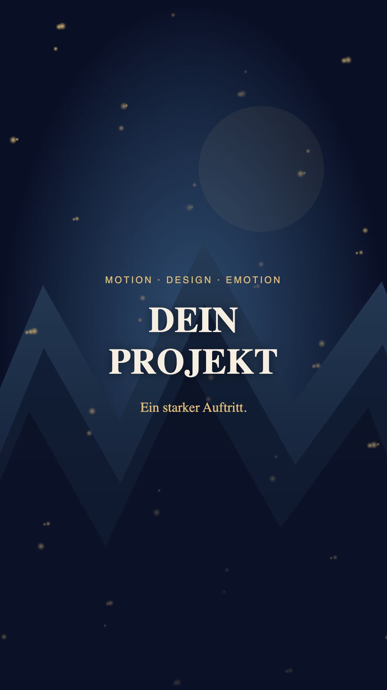

# MGD Motion Graphics Video Skill

Ein deutsch dokumentierter Skill für **Reels, YouTube-Videos, Werbefilme,
Motion Graphics und Animationen**. Er verbindet Projektmaterial, Dramaturgie,
bewegte Typografie, Compositing, Schnitt, Ton und überprüfbare Videoexporte.

**FFmpeg und Remotion** sind die vorgesehenen Werkzeuge. Weitere lokale Video-Skills
werden nur nach vorheriger ausdrücklicher Zustimmung ausgewählt oder verwendet.
Lokale Werkzeuge bilden den Kern. Passende ECC-Skills und Medien-Plugins können
gezielt ergänzt werden. Der Aufbau orientiert sich am
[Video Composer Skill](https://github.com/MichaelGahnDESIGN/ChatGPT-Video-Composer-Skill)
und der MGD-Skill-Struktur. Version **0.4.0**.

## Was enthalten ist

- Ein kompakter [Skill-Einstieg](skills/mgd-motion-graphics-video/SKILL.md) mit
  vertiefenden Anleitungen für Gestaltung, Formate, Ton, Qualität und Fehlersuche.
- Ein Installer mit Vorschau, festen Upstream-Versionen, SHA-256-Prüfung,
  wählbaren Profilen und Schutz bestehender Skill-Installationen.
- Ein neutraler lokaler Demo-Baukasten: **9:16, 16:9 und 1:1**, räumliche
  Vektorwelt, bewegte Schrift, Lichtpartikel und konfigurierbare Schluss-Haltezeit.
- Umgebungsprüfung, projektlokales Toolsetup, Renderhilfe und Exportprüfung.
- [Versionierte Wiki-Dokumentation](docs/wiki/Home.md), Tests und
  [Prüfnachweise](docs/arbeitsberichte/).

Erfahrungen aus realen Iterationen sind als allgemeine Fehlerhilfen enthalten:
sichtbare Nebelkanten, abgeschnittene Gruppen, strichartige Partikel, zu kurze
Schlussbilder, nicht reproduzierbare Zeitsteuerung und NAS-Probleme. Private Medien,
Projektpfade und Inhalte gehören nicht zum öffentlichen Paket.



## Charaktere konsistent gestalten

Bei Figuren gehören ein Charakter-Sheet und ein echtes, zum Zielmodell passendes
LoRA zur Standardproduktion. Der Assistent fragt vorher nach verbindlichen
Referenzen, vorhandenen Sheets/LoRA-Pfaden, dem gewünschten Bildanbieter und einem
kompatiblen LoRA-Trainer. ChatGPT/OpenAI (Cloud), lokale Werkzeuge, Higgsfield und
andere Anbieter werden bewusst unterschieden; Datenübertragung und Kosten sind
vorher zu klären. Ein vorhandenes geprüftes LoRA ersetzt erneutes Training.

[Charakter-Sheets und LoRA im Wiki](docs/wiki/Charaktere-und-LoRA.md) erklärt den
Dialog, Training, Kompatibilität, Datenschutz und die prüfbare Übergabe.
Es wird kein LoRA-Training in einem Werkzeug versprochen, das diese Funktion
nicht anbietet. Die Erweiterung startet selbst weder Training noch Uploads.

## Alle Aufrufe und vollständiges Wiki

[Das ausführliche GitHub-Wiki](https://github.com/MichaelGahnDESIGN/MGD-Motion-Graphics-Video-Skill/wiki)
führt durch Einrichtung, alle Videoarten, Gestaltung, Effekte, Ton, Qualität,
Datenschutz, NAS-Arbeit und Fehlerbehebung. Die Inhalte liegen zusätzlich unter
[docs/wiki](docs/wiki/Home.md) versioniert.

Mit `--aliases` werden alle 14 Aufrufvarianten installiert. Beispiele:

| Gewünschter Aufruf / Claude Code | Codex-Skill |
|---|---|
| `/MGD-Motion` | `$mgd-motion` |
| `/reel` | `$reel` |
| `/MGD-Video` | `$mgd-video` |
| `/MGD-Reel` | `$mgd-reel` |
| `/MGD-Trailer` | `$mgd-trailer` |
| `/MGD-Erklärvideo` | `$mgd-erklaervideo` |
| `/MGD-Motion-Graphic-Animation` | `$mgd-motion-graphic-animation` |
| `/MGD-Anime` | `$mgd-anime` |
| `/MGD-Werbefilm` | `$mgd-werbefilm` |
| `/MGD-Produktvideo` | `$mgd-produktvideo` |
| `/MGD-YouTube` | `$mgd-youtube` |
| `/MGD-Logo-Animation` | `$mgd-logo-animation` |
| `/MGD-Loop` | `$mgd-loop` |
| `/MGD-Video-Optimieren` | `$mgd-video-optimieren` |

Codex verwendet explizite Skill-Aufrufe und die Skill-Auswahl. Eigene veraltete
Slash-Prompts werden nicht als neue Integration installiert. Für Claude Code
können die mitgelieferten Befehlsdateien separat eingerichtet werden.
[Alle Prompts](docs/wiki/Befehle.md) · [Einrichtungsprompt](docs/wiki/Projektstart.md)

## Schnellstart

Voraussetzungen: Python ≥3.9. Für Videos zusätzlich Node.js ≥22 mit npm,
FFmpeg/ffprobe und kompatibles Chrome/Chromium. Der Installer selbst braucht
weder npm noch GitHub-Anmeldung.

```bash
git clone https://github.com/MichaelGahnDESIGN/MGD-Motion-Graphics-Video-Skill.git
cd MGD-Motion-Graphics-Video-Skill
python3 skills/mgd-motion-graphics-video/scripts/doctor.py
```

Installationsplan für ein gewähltes Projekt ansehen:

```bash
python3 skills/mgd-motion-graphics-video/scripts/install.py --target /PFAD/PROJEKT/.agents/skills --profile core
```

Nach Prüfung mit `--apply` ausführen. Ohne Profil werden keine Fremdskills geladen. Ohne `--aliases` wird nur der
Hauptskill installiert. `core` bietet ausschließlich ECC video-editing als ausdrücklich zu wählende Ergänzung.
Auch vorhandene lokale Zusatzskills erst nach Zustimmung verwenden.
Weitere Profile und die bewusst getrennte globale Installation stehen in der
[Installationsanleitung](skills/mgd-motion-graphics-video/references/installation.md).
Keine bestehende abweichende Skill-Installation wird überschrieben.

Ein eigenes Demo-Projekt erzeugen:

```bash
python3 skills/mgd-motion-graphics-video/scripts/new_project.py /PFAD/PROJEKT/mein-reel --preset reel --end-hold 4
python3 skills/mgd-motion-graphics-video/scripts/setup_tools.py /PFAD/PROJEKT/mein-reel --apply
cd /PFAD/PROJEKT/mein-reel
python3 tools/build.py
```

Ersetze die Platzhalter durch echte absolute Pfade. Für Querformat `--preset youtube`,
für Quadrat `--preset square`. Danach checken, ansehen und rendern wie in der
[Anleitung](skills/mgd-motion-graphics-video/references/installation.md).
Auf NAS-Systemen Abhängigkeiten und Renderarbeit in einer erlaubten lokalen
Arbeitskopie ausführen; Quellen und Ergebnisse anschließend geprüft zurückgeben.

## Global mit allen Aufrufen installieren

Nur bei entsprechendem Benutzerauftrag:

```bash
python3 skills/mgd-motion-graphics-video/scripts/install.py --target "$HOME/.agents/skills" --aliases --global
python3 skills/mgd-motion-graphics-video/scripts/install.py --target "$HOME/.agents/skills" --aliases --global --apply
```

Danach `$mgd-motion` starten; fehlenden Video-Projektordner und erstes Thema
zusammen erfragen lassen. Bereits vorhandene Angaben werden übernommen.
Für Claude Code und projektbezogene Einrichtung siehe
[Installation](docs/wiki/Installation.md). Abweichende vorhandene Dateien bleiben erhalten.

## Verwendung im Agenten

Nach der Installation den Skill beispielsweise so aufrufen:

> Nutze $mgd-motion-graphics-video. Erstelle aus den Materialien dieses Projekts
> ein dynamisches Fantasy-Reel in 9:16. Runde magische Lichtpartikel, Regen hinter
> dem Motiv, keine zusätzlichen Whooshes. Halte den vollständig lesbaren Schluss
> sechs Sekunden und liefere einen hochwertigen MP4-Export mit Prüfbericht.

Oder:

> Nutze $mgd-motion-graphics-video für einen erklärenden YouTube-Film in 16:9 mit
> Kapiteln und Untertiteln. Verwende die vorhandene CI und die freigegebenen Medien.

Der Stil wird pro Projekt gewählt. Fantasy ist ein Beispiel, keine feste Vorgabe.
Ein vorhandenes Projekt wird gezielt weiterbearbeitet, ohne unnötigen Neustart.

## ElevenLabs für natürliche Sprecherstimmen

Optional lässt sich der offizielle gehostete **ElevenLabs-MCP per OAuth**
verbinden. Danach können passende Stimmen ausgewählt, Credit-Kosten vorab
geprüft und Sprecherfassungen erzeugt werden. Die Videomischung bleibt lokal
mit FFmpeg oder Remotion. Ein kopierter Skill richtet die Verbindung nicht ein;
Kontoanmeldung, Rechte und Kostenfreigabe werden getrennt geprüft.

[Einrichtung und Praxis im Wiki](docs/wiki/ElevenLabs-MCP.md) ·
[Arbeitsanleitung für den Skill](skills/mgd-motion-graphics-video/references/elevenlabs-mcp.md)

## Grenzen, Kosten und Rechte

Der Skill selbst ist MIT-lizenziert. Zusatzskills behalten ihre jeweilige Lizenz.
Werkzeuge, Schriftarten, Musik, Medien und Generatoren haben eigene Bedingungen;
[Remotion](https://www.remotion.dev/docs/license) nicht pauschal als kostenlos
für jeden Einsatz behandeln. Details: [Drittanbieter](THIRD_PARTY.md).

Keine automatische Cloudgenerierung, Kontoverbindung oder Veröffentlichung.
Lokales Rendern benötigt Rechenleistung; externe Dienste können Credits oder
Gebühren verursachen. Ein kopierter Skill installiert keinen MCP-Server.
Plugins werden nur verwendet, wenn ihre Funktion tatsächlich verfügbar und der
betreffende Zugriff autorisiert ist.

Die technische Exportprüfung ersetzt keine Sicht-/Hörkontrolle und keine echte
Abnahme auf Instagram oder YouTube. Der Demo ist stumm; private Projektdaten
müssen für seine Nutzung nicht hochgeladen werden.

## Entwicklung und Prüfung

```bash
python3 tools/build_commands.py --check
python3 tools/check.py
```

Die Standardprüfungen laufen ohne Netzwerk und ohne zusätzliche Python-Pakete.
Aktuelle Prüfergebnisse und der Remotion-Testexport stehen im
[Prüfbericht 0.4.0](docs/arbeitsberichte/0.4.0-pruefung.md). Historische Berichte
belegen ausschließlich ihre damalige Version.
Änderungen an Upstream-Versionen erfolgen bewusst über
`tools/update_dependency_lock.py`, mit anschließender Prüfung und Testexport.

[MIT-Lizenz](LICENSE) · [Wiki](docs/wiki/Home.md) ·
[Skill-Anleitung](skills/mgd-motion-graphics-video/SKILL.md)
